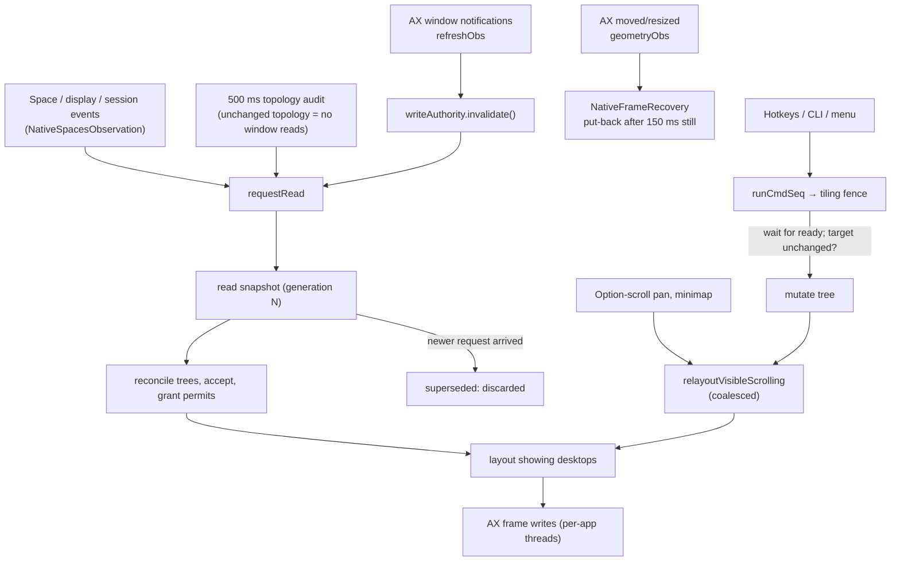

# State and events

## Single owner (verified)

All mutable workspace state is owned on the **main actor** by one runtime object,
`WinMuxRuntime` (`runtime/WinMuxRuntime.swift`), whose `native` member
(`NativeWorkspaceLifecycle`, `runtime/NativeWorkspaceLifecycle.swift`) owns the
observation, the per-desktop strips (`NativeSpaceLayouts`), the tiling fence, write
permits, navigation, moves, persistence and focus holds. There is no second copy of
the trees: commands, observation, the pan, the minimap and persistence all read and
mutate the same `Workspace` objects, on the main actor.

Accessibility calls run on **one thread per application** (`tree/MacApp.swift`,
`:94`), each with its own run loop. Per-window frame writes are run-loop jobs keyed by
window (`setFrameJobs`, `MacApp.swift`): a new write for a window supersedes the
pending one, and `cancelPendingFrameWrites()` drops them all when the observation is
invalidated. Results return to the main actor; AX threads never touch the trees.

## Event sources and handling

| Requirement | Mechanism | Evidence |
| --- | --- | --- |
| Deterministic, serialized transitions | Main-actor ownership; one observation read at a time | `NativeSpacesObservation` |
| Stale events | Generation numbers; an invalidation revokes membership before a new snapshot is published; superseded reads cannot publish older membership | `NativeSpaceLayouts.reconcile`, `NativeTilingCoordinator.invalidate`  |
| Commands against moved targets | `NativeCommandTargetFence` records the target desktop, display and window; refuses after reconciliation if any changed | `runtime/NativeCommandTargetFence.swift`, `NativeTilingTest` |
| No AX feedback loops | Own writes during a pan do not revoke permits (`nativePanIgnoresNotification`); app-originated moves are put back at most 3× per 10 s | `layout/refresh.swift`, `runtime/NativeFrameRecovery.swift` |
| Coalescing | `relayoutVisibleScrolling` coalesces requests into one pass; one pending AX write per window | `NativeTilingCoordinator.swift`, `MacApp.setFrameJobs` |
| Safe cancellation | Invalidation cancels pending frame writes; navigation supersedes older requests | `NativeTilingCoordinator.invalidate`, `NativeSpaceNavigator` |
| Planned vs applied frames | Planned: `lastAppliedLayoutPhysicalRect` (the requested frame). Applied: read back only by put-back after a move notification | **Partial** — see below |
| Suspension | `enable off` stops tiling and shortcuts; `RunSessionGuard` gates refresh | `layout/refresh.swift` |

## Open questions

1. **Applied frames.** `lastAppliedLayoutPhysicalRect` records what was *requested*.
   A write that macOS silently clamps without a moved notification is not detected.
   If a measurement shows this happens, record the read-back frame from
   the AX thread's write job as `observedFrame` and let the put-back budget handle
   it. Do not add a second write path.
2. **Polling.** The 500 ms topology audit is the only periodic work. It exists because
   Space notifications can be missed (`NativeSpacesObservation`). Measure its share
   of idle wakeups before changing it.
