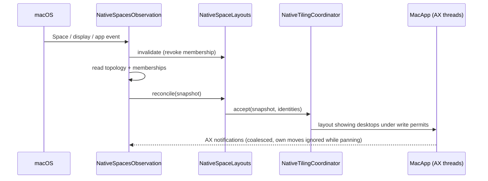

# Native Spaces integration

The user-facing behaviour is described in [Native Spaces](../NATIVE_SPACES.md). This
document records the architecture and what remains to investigate.

## Design (verified)

- **One logical workspace per native desktop.** `NativeSpaceLayouts.reconcile`
  (`tree/NativeSpaceLayouts.swift`) maps each observed desktop UUID to a retained
  `Workspace`; renumbering in Mission Control keeps the strip with its desktop.
  A desktop belongs to one display, so "per Space and display" is per desktop.
- **Viewport per desktop.** `Workspace.scrollingOffset` lives on that workspace, so
  switching desktops and back preserves the viewport within a session
  (`testSpaceSwitchRetainsIndependentStacksAndFloatingWindows`).
- **Membership comes from macOS.** Window-to-desktop membership is read from
  WindowServer; StripMuxX never infers it from geometry.
- **Switching and moving are requests.** `NativeSpaceNavigator` posts a Dock swipe and
  succeeds only on a confirmed landing; `NativeWindowSpaceMoves` moves windows by ID
  through SkyLight and edits a strip only after confirmation.
- **Fullscreen Spaces** are observed and excluded; no strip is created
  (`testADisplayShowingAFullscreenSpaceHasNoDesktopAndCreatesNone`).
- **Mission Control** pauses layout while its overlay is detected (macOS 27 only).
- **No virtual workspaces.** Hidden desktops' windows are hidden by macOS itself.

## Private APIs (verified; isolated in `Sources/NativeSpaces`)

| Use | API | Fallback |
| --- | --- | --- |
| Read Spaces and memberships | SkyLight read calls, dynamically resolved | Observation suspended; `doctor` reports it |
| Switch desktops | Synthetic Dock swipe events (macOS 27 payload) | Command fails up front |
| Move windows between desktops | `SLSBridgedMoveWindowsToManagedSpaceOperation` via symbol-table lookup | Command fails; `doctor` reports moves unavailable |
| Add desktops | `NativeSpaceCreator` | Top-up stops and reports |

All work with SIP enabled. Each is optional: tiling within the showing desktop needs
only Accessibility.

## Open questions (Phase 1)

| Question | Status |
| --- | --- |
| Behaviour when "Displays have separate Spaces" is off (one Space spanning displays) | **Unverified.** Setup check warns (`ui/settings/SetupCheck.swift:44`); layout behaviour across a spanning Space is untested |
| Display disconnect/reconnect with populated strips | Unit-tested topology handling; **no physical check** recorded |
| Sleep/wake with stale AX references | Observation re-reads on wake; **no physical check** recorded |
| Stage Manager | **Unverified** |
| Viewport after restart | Not persisted; focus reveal recomputes it. **Proposed:** persist ([roadmap](implementation-roadmap.md)) |
