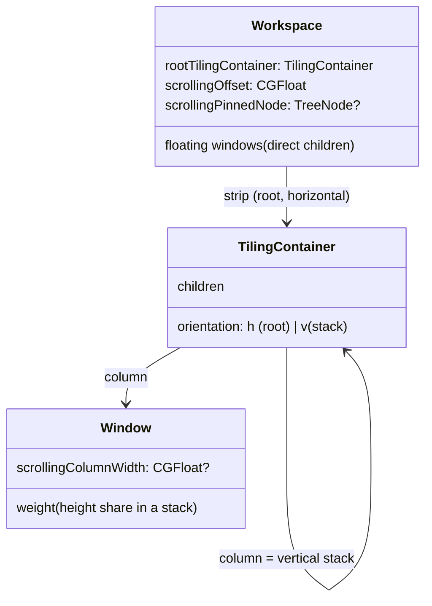

# Scrolling layout engine

## Current data model (verified)

- One `Workspace` per native desktop (`tree/WorkspaceType.swift`), held by
  `NativeSpaceLayouts` keyed by Space UUID.
- The root is the strip; each child is a column: a `Window` or a vertical
  `TilingContainer` of at least two windows. `normalizeContainers()` keeps that shape
  (`tree/normalizeContainers.swift`).
- A column's width is a **share of the usable width** (`scrollingColumnWidth`, 0.1…1;
  default `[scrolling] column-width = 0.49`). Stack heights are weights.
- The viewport is one number per desktop, `scrollingOffset`, in strip coordinates.
- Floating windows are children of the workspace and never enter the geometry.

## Geometry (verified pure)

`calculateScrollingWorkspaceGeometry(_:)` (`tree/ScrollingWorkspace.swift:62`) takes
`ScrollingWorkspaceGeometryInput` (bounds, parking bounds, offset, column preferred and
minimum widths, gaps, walls, preview width, focused index) and returns, per column,
a **logical** frame (where it is on the strip) and a **physical** frame (where the
window is placed), a visibility class, the clamped offset and its range, and a
back-to-front stacking order. It reads no global state and calls no AppKit API.

Rules it implements:
- Column width = `max(round(areaWidth × share), app minimum + gaps)`; a lone column
  fills the area.
- A strip narrower than the area is centred (negative offset); a wider one is clamped
  to `0 … total − areaWidth`.
- Columns wholly outside the viewport become 25-point edge previews, or are placed
  inside the display when a neighbouring display lies on that side (a "wall"). See
  [window parking](window-parking.md).
- A focused column wider than the display (a learned app minimum) is centred.

Viewport policy is in `ScrollingWorkspaceMetrics` (same file): `revealedOffset`
(minimal scroll), `centeredOffset`, and `focusedOffset` for the three
`center-focused-column` modes.

## Gap to Niri

Reference: Niri `src/layout/scrolling.rs` (GPL-3.0; studied, not copied).

| Niri behaviour | StripMuxX today | Gap |
| --- | --- | --- |
| Ordered columns, active column, view offset | Same (offset is absolute, not relative to the active column) | None functionally |
| Width as proportion **or fixed** pixels; presets cycle | Share only; `scrolling-width next|previous|full`; `resize width ±N` converts to a share (`tree/StripEdits.swift`, `resizeColumn`) | **Fixed widths** do not survive a display change as pixels. [ADR 0003](../decisions/0003-column-width-model.md) |
| Window heights: auto (weights), fixed, preset | Weights only; `resize height ±N` | Fixed/preset heights: not in MVP |
| New window to the right of the active column | Same (`tree/NewWindowBinding.swift:24`) | None |
| Close a just-opened window → focus returns to the previous column | Not implemented (assumption: focus follows macOS) | **Gap**, small |
| Consume / expel (`consume-or-expel-window-left/right`) | `join-with left/right` consumes; `move left/right` out of a stack expels | None |
| `center-focused-column`: never / always / on-overflow | Same three modes, but `on-overflow` centres whenever the column is not wholly visible | **Semantic difference:** Niri centres only when the target and the column focus came from do not fit together. [ADR 0004](../decisions/0004-on-overflow-semantics.md) |
| `always-center-single-column` | A lone column fills the width (`fullscreen-width` limits it) | Different by design |
| Minimal scroll to reveal a column | `revealedOffset` | None |
| Scroll the view without moving focus (keyboard) | Only Option-scroll pan and the minimap | **Gap:** add a `scroll` command. [ADR 0005](../decisions/0005-keyboard-viewport-scroll.md) |
| Animated view and window movement | None: frames are written once | **Deferred** (Phase 5) |
| Tabbed columns | Removed, out of scope | — |

## Proposed changes (Phase 2 scope)

1. **Viewport policy as a value function.** `focusedOffset` reads `config` by default
   and three call sites assign `scrollingOffset` themselves. Introduce one pure
   `viewportOffset(focusing:previous:current:mode:metrics)` and route all three
   through it. This is where Niri's `on-overflow` rule would live.
2. **Width model.** Add an optional fixed width per column next to the share, resolved
   in the geometry input. Only if ADR 0003 is approved.
3. **Scroll command.** `scroll left|right [amount]` and `scroll to-focus`, changing
   only `scrollingOffset` (relaid out through the existing coalesced
   `relayoutVisibleScrolling`, `runtime/NativeTilingCoordinator.swift:174`).
4. **Direct geometry tests.** The pure function has no test of its own today; it is
   only exercised through commands. Add table-driven tests (see
   [testing strategy](testing-strategy.md)).

Nothing here touches macOS APIs, so all of it is testable without windows.
