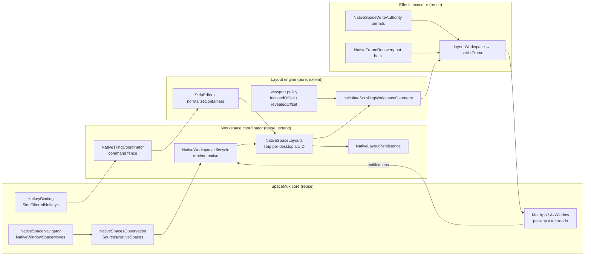

# WinStrip architecture overview (Phase 0)

WinStrip is the plan for a Niri-style scrolling window manager on native macOS
Spaces. This repository already ships most of it as **StripMuxX**: SpaceMux's native
Spaces integration with a single scrolling strip per desktop, and every other layout,
virtual workspaces and tabs removed. Phase 0 therefore audits what exists and
identifies the gaps, instead of designing a new system.

Claims are marked: **verified** (read in this repository, with a source reference),
**measured** (run here), **reference** (read in another project), **assumption**
(not yet checked) and **proposed** (a design choice awaiting approval).

| Document | Contents |
| --- | --- |
| [Reuse map](spacemux-reuse-map.md) | Every subsystem: reuse, extend, refactor or leave |
| [Scrolling layout engine](scrolling-layout-engine.md) | Data model, geometry, and the gap to Niri |
| [Native Spaces integration](native-spaces-integration.md) | One strip per desktop, displays, fullscreen |
| [Window parking](window-parking.md) | Offscreen columns: findings and experiments |
| [State and events](state-and-events.md) | Ownership, serialization, stale events |
| [Testing strategy](testing-strategy.md) | Unit, integration and manual coverage |
| [Implementation roadmap](implementation-roadmap.md) | Phases, backlog, risks, MVP criteria |
| [Decisions](decisions/) | Choices that need approval |

## Executive summary

- **Verified:** the product's core already exists. Each native desktop has one
  `Workspace` whose `rootTilingContainer` is the strip; a column is a window or a
  vertical stack (`Sources/AppBundle/tree/normalizeContainers.swift`). The strip
  geometry is a pure function, `calculateScrollingWorkspaceGeometry`
  (`Sources/AppBundle/tree/ScrollingWorkspace.swift:62`), with a per-desktop viewport
  offset (`Workspace.scrollingOffset`, `Sources/AppBundle/tree/WorkspaceType.swift:14`).
- **Verified:** native Spaces integration is mature: observation with stale-read
  revocation, UUID-keyed strips, confirmed desktop switches and confirmed
  cross-desktop moves, all behind a command fence. None of it needs rewriting.
- **Verified:** offscreen columns are never fully offscreen. They sit at the display
  edge as 25-point previews, or inside the display when a neighbouring display is on
  that side. Paneru and OmniWM independently arrived at the same constraint.
- **Gaps against Niri (verified absent):** keyboard scrolling of the viewport without
  moving focus; fixed-pixel column widths (widths are shares only); Niri's
  `on-overflow` rule (StripMuxX centres whenever the column is not wholly visible);
  restoring focus to the previous column when a new window closes; animations;
  a viewport that survives restart; direct unit tests of the pure geometry.
- **Measured:** idle cost with 6 windows on one desktop and one display: 0.07% of one
  core, about 8.5 wakeups/s and about 78 MiB resident over 60 s. Larger window counts
  and two displays are not measured yet.
- **Proposed:** no new modules. The "layout engine", "workspace coordinator" and
  "effects executor" of the brief map onto existing code; the work is a set of
  targeted additions and one extraction (viewport policy into the pure layer).

## Component map

## Module structure

**Proposed:** keep the current module layout. The brief's four components already
exist with clear owners:

| Brief component | Existing owner | Change |
| --- | --- | --- |
| SpaceMux core | `Sources/NativeSpaces`, `tree/MacApp.swift`, `config/HotkeyBinding.swift`, `runtime/NativeSpaceNavigator.swift` | None |
| Layout engine | `tree/ScrollingWorkspace.swift`, `tree/StripEdits.swift`, `tree/normalizeContainers.swift`, `layout/ColumnFrames.swift` | Extract viewport policy so it takes values, not `config`; add width model and tests |
| Workspace coordinator | `runtime/NativeWorkspaceLifecycle.swift`, `tree/NativeSpaceLayouts.swift`, `runtime/NativeTilingCoordinator.swift` | Add focus-on-close and viewport persistence |
| Effects executor | `layout/layoutRecursive.swift`, `tree/MacApp.swift`, `NativeSpaces/NativeSpaceWriteAuthority.swift`, `runtime/NativeFrameRecovery.swift` | Add applied-frame readback where experiments justify it |

A separate Swift package for the engine is **not** proposed: the geometry is already
free of AppKit side effects, and the tree types it reads are shared with persistence
and commands. Moving them would be churn without a behavioral gain.

## Deviations from the brief

- The brief assumes WinStrip is built anew on SpaceMux. The repository already
  contains Phases 2–5 in large part; the roadmap is rewritten as gap closing.
- The brief asks for a `WindowParkingStrategy` only if justified. It is not: native
  Spaces hide inactive desktops for us, and intra-strip placement is one pure rule.
- Pinned columns, listed as post-MVP, already exist (`scrolling-pin`).
- Naming: WinStrip versus StripMuxX is open ([ADR 0001](decisions/0001-product-name.md)).
